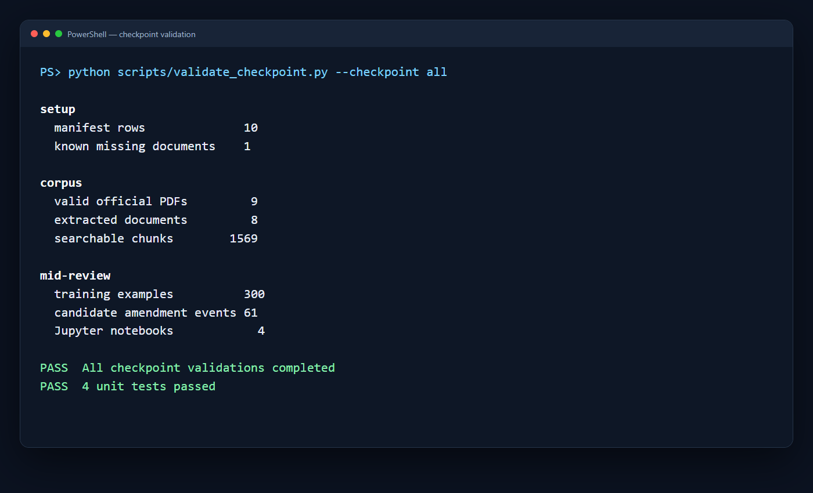
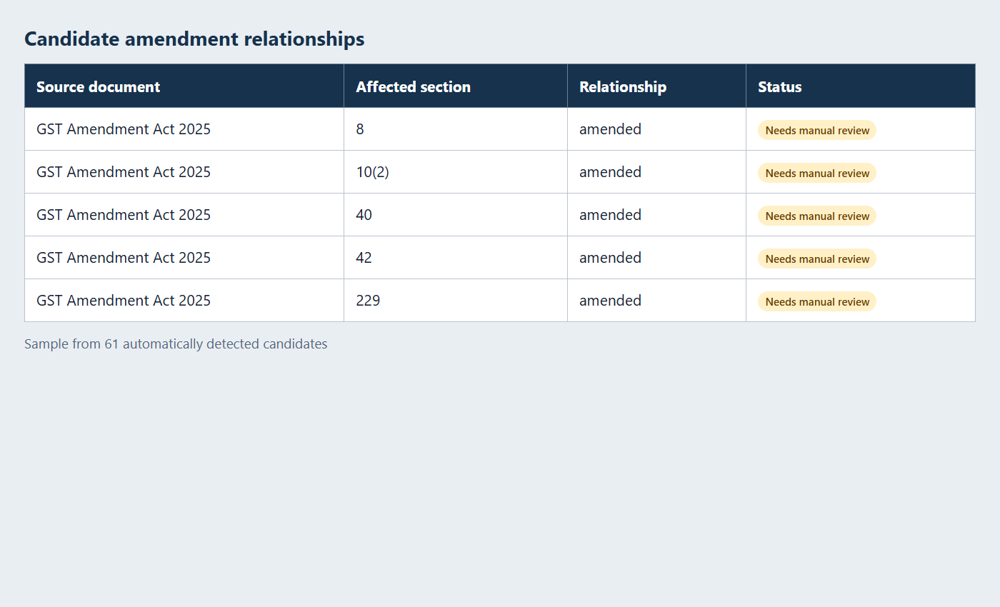
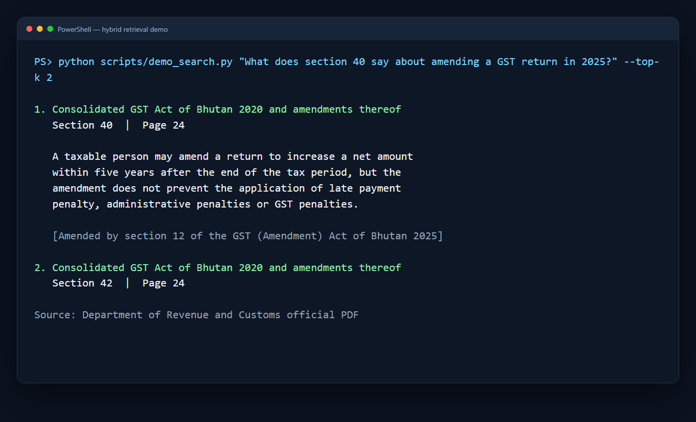

# Version-Aware RAG for Bhutan GST — Mid-Review Technical Report

> Historical checkpoint. See the [current project README](../README.md) for GST Lens and the latest saved evaluation.

**Course:** CSA402 Natural Language Processing  
**Team:** Garab Phuntsho Wangyel, Tshering Wangchuk, and Sonam Chophel Dorji  
**Project stage:** Mid-review checkpoint  
**Corpus cut-off:** 30 September 2026

## 1. Purpose of this report

This report explains everything implemented for the mid-review, the results obtained, how to rerun the work, and how it connects to the presentation. It is written so that every group member can understand the system and add the project to Git without committing large generated files.

The current work is a functioning **information-retrieval prototype**. It retrieves official Bhutan GST evidence and performs preliminary date filtering. It is not yet the final legally verified question-answering system.

## 2. Problem being solved

Bhutan GST rules exist across an original Act, amendments, consolidated documents, rules, and official notices. Two passages may be semantically similar while only one was legally applicable on the date in a user's question.

A standard RAG system may therefore return a relevant-looking but outdated, repealed, replaced, or not-yet-effective provision. The project aims to retrieve the correct provision for the requested date and preserve its official source, section, and page citation.

## 3. Proposed final solution

The complete project is designed as a two-phase pipeline:

1. **Prepare versioned evidence:** collect official PDFs, extract English text, split it into sections, record dates and amendment relationships, generate retriever training data, fine-tune MiniLM, and build search indexes.
2. **Answer with the applicable version:** detect the target date, retrieve evidence, remove legally invalid versions, generate a cited answer, or abstain when the valid version cannot be established.

The proposal fine-tunes the **embedding/retrieval model**, not the answer-generating LLM. The model used at this checkpoint is `sentence-transformers/all-MiniLM-L6-v2`.

## 4. Mid-review scope and status

The mid-review covers the work planned through approximately weeks 5–6:

| Checkpoint | Work completed | Status |
|---|---|---|
| Project setup | Python package, configuration, folders, scripts, notebooks, and tests | Complete |
| Corpus collection | Official DRC source manifest, PDF download, SHA-256 hash, and PDF validation | Complete with one known missing Act |
| Text processing | Page extraction, English-page filtering, section-aware chunking, and provenance | Complete |
| Version metadata | Preliminary dates, status fields, and amendment-event candidates | Complete; legal review required |
| Training data | 300 question–positive–hard-negative triples | Complete; human review required |
| MiniLM experiment | Baseline evaluation, one CPU fine-tuning epoch, and repeated evaluation | Complete |
| Retrieval prototype | BM25, FAISS dense search, reciprocal-rank fusion, and preliminary date filtering | Complete |
| Final three-system comparison | Standard RAG, date-filtered RAG, and full version-aware RAG | After mid-review |
| Final benchmark | 120 manually verified questions and final statistical comparison | After mid-review |

## 5. Software and environment

The verified local environment used:

- Windows and PowerShell
- Python 3.12.2
- JupyterLab 4.5.7
- PyTorch 2.11.0, CPU execution
- Transformers 4.48.3
- Sentence Transformers 3.4.1
- FAISS CPU 1.14.2
- scikit-learn 1.8.0
- pandas 3.0.2
- pypdf 6.7.1
- rank-bm25 0.2.2

The project uses a local `.venv` so dependency versions do not conflict with global Python packages. The `.venv`, raw PDFs, generated JSONL files, trained model, search indexes, results, and private presentation-build files are excluded from Git.

## 6. Corpus and data preparation

### 6.1 Source policy

Only official Department of Revenue and Customs sources are included in the first corpus freeze. The source manifest records the document title, type, date, source URL, local path, and verification status.

### 6.2 Corpus result

| Measure | Result |
|---|---:|
| Manifest rows | 10 |
| Official PDFs downloaded and validated | 9 |
| Documents with usable English text | 8 |
| Searchable chunks | 1,569 |
| Candidate amendment events | 61 |
| Image-only documents flagged for OCR | 1 |

The tenth manifest row deliberately tracks the missing official **GST Amendment Act 2026**. A DRC notification dated 25 June 2026 refers to it, but the Act PDF was not available in the collected official sources. Keeping the gap visible prevents the system from silently claiming complete legal coverage.



### 6.3 Processing steps

Each valid PDF goes through the following process:

1. Validate the file signature and calculate its SHA-256 hash.
2. Extract text page by page with `pypdf`.
3. Apply an English-text heuristic and flag empty or image-only pages.
4. Detect section boundaries using legal-heading patterns.
5. Split long sections into searchable chunks while retaining provenance.
6. Attach fields such as document ID, document type, page, section, source URL, publication date, effective dates, and verification status.
7. Detect possible amendment phrases and store them as reviewable candidate relationships.

All 1,569 chunks currently remain marked for manual legal review. This is intentional: automated extraction must not be treated as legal verification.



## 7. Training-data construction

The pipeline generated **300 training triples**. Each triple contains:

- a question,
- the relevant positive passage, and
- a hard negative passage with similar vocabulary but the wrong section or version.

Hard negatives are valuable because the main project problem is not only finding a related GST topic; it is distinguishing between similar legal versions. TF-IDF similarity helps select challenging negative passages.

All generated examples include `manual_review_required = true`. They are development data, not the final 120-question benchmark. The training run used a capped set of 240 examples, producing 192 training examples and 48 held-out development examples.

## 8. MiniLM fine-tuning experiment

### 8.1 Configuration

- Base model: `sentence-transformers/all-MiniLM-L6-v2`
- Objective: triplet loss
- Margin: 0.35
- Epochs: 1
- Batch size: 8
- Device: CPU
- Training examples: 192
- Development examples: 48

The original model and fine-tuned model were evaluated on the same held-out development split. The script selects the fine-tuned model only when it improves the retrieval metrics.

### 8.2 Results

| Metric | Original MiniLM | Fine-tuned MiniLM | Improvement |
|---|---:|---:|---:|
| Recall@5 | 0.521 (52.1%) | 0.813 (81.3%) | +0.292 (+29.2 points) |
| MRR@10 | 0.420 (42.0%) | 0.646 (64.6%) | +0.227 (+22.7 points) |

**Recall@5** measures how often the correct passage appears among the first five results. **MRR@10** rewards the system for putting the first correct result nearer the top of the first ten results.

The selection rule chose the **fine-tuned model**. These are development results only and must not be presented as final legal-system performance.

## 9. Retrieval prototype

The working retriever combines:

- **BM25** for exact words, section numbers, and legal phrases;
- **fine-tuned MiniLM embeddings** for semantic similarity;
- **FAISS** inner-product search over normalized embeddings; and
- **reciprocal-rank fusion (RRF)** to combine sparse and dense rankings.

The built FAISS index contains all **1,569 chunks**. The demo also parses an explicit year or date in the question and applies a preliminary validity filter when the metadata is available.

For the demonstration query about Section 40 in 2025, the top result is from the consolidated Act, Section 40, page 24, and the result text contains the 2025 amendment reference. The source information remains visible for verification.



This proves that evidence retrieval is operational. Answer generation, full legal-version resolution, and abstention logic remain in the next phase.

## 10. Validation completed

The following checks passed:

- Setup, corpus, and mid-review checkpoint validation
- Four unit tests covering core processing and retrieval behaviour
- Execution of all four Jupyter notebooks
- Baseline and fine-tuned retrieval evaluation
- FAISS index construction and demo-query execution
- PowerPoint structural validation and visual review of all 15 slides

The four notebooks are:

1. `01_corpus_and_extraction.ipynb`
2. `02_versioned_sections.ipynb`
3. `03_training_and_minilm.ipynb`
4. `04_mid_review_demo.ipynb`

The notebooks explain the workflow for review and learning, while the reusable `src/gst_rag` modules prevent duplicated or hidden notebook logic.

## 11. Project structure

```text
NLP Project/
├── Dataset/
│   ├── metadata/                 # corpus manifest, extraction report, events
│   ├── raw_pdfs/                 # generated/downloaded; ignored by Git
│   ├── extracted_text/           # generated; ignored by Git
│   ├── processed_sections/       # generated; ignored by Git
│   └── training_examples/        # generated; ignored by Git
├── docs/
│   ├── MID_REVIEW_TECHNICAL_REPORT.md
│   └── images/                   # report screenshots
├── indexes/                      # generated FAISS/BM25 artifacts; ignored
├── models/                       # trained model; ignored
├── notebooks/                    # four teaching and review notebooks
├── output/presentation/          # final mid-review PowerPoint
├── results/                      # generated metrics and reports; ignored
├── scripts/                      # pipeline, training, indexing, demo, validation
├── src/gst_rag/                  # reusable Python implementation
├── tests/                        # unit tests
├── project_config.yaml
├── pyproject.toml
├── README.md
└── MID_REVIEW_STATUS.md
```

## 12. How a team member can run the project

From PowerShell in the project folder:

```powershell
.\.venv\Scripts\Activate.ps1
python scripts\validate_checkpoint.py --checkpoint all
python scripts\demo_search.py "What did Section 40 provide about amending a GST return in 2025?" --top-k 3
python -m pytest -q
python -m jupyter lab
```

If the environment must be recreated, follow the setup instructions in `README.md` and install the project in editable mode. The main automated stages are available through:

```powershell
python scripts\run_to_mid_review.py --skip-training
python scripts\train_minilm.py
python scripts\build_indexes.py
```

The raw corpus should be reviewed before retraining. Running the entire pipeline may take time on CPU, especially embedding-model training and indexing.

## 13. Connection to the presentation

| Slides | Presenter | What to learn and explain |
|---|---|---|
| 1–4 | Garab | Project timeline, problem, proposed two-phase method, corpus, and progress evidence |
| 5–7 | Tshering | The PDF-to-chunk-to-vector transformation, training triples, and exact MiniLM results |
| 8–11 | Sonam | Live retrieval evidence, implementation checks, current limitations, and next phase |

The final presentation is `output/presentation/Bhutan_GST_RAG_Mid_Review_11_Slides_Final.pptx`. Speaker notes inside the slides contain talking points, likely questions, and short answers.

## 14. Important Q&A answers

**Did the proposal include fine-tuning?**  
Yes. It proposes fine-tuning MiniLM as the embedding/retrieval model. It does not propose fine-tuning the answer-generating LLM.

**Why MiniLM?**  
It is compact, CPU-friendly, reproducible, and suitable for comparing retrieval before and after domain adaptation.

**Why is this not yet a legally verified final system?**  
Dates and amendment relationships still require manual verification, one notice requires OCR, the official 2026 Amendment Act is missing, and the final benchmark and three-system comparison are not complete.

**Why use hybrid retrieval?**  
BM25 handles exact legal terms and section numbers, while MiniLM handles semantic similarity. RRF combines their strengths.

**Did the model see the final benchmark?**  
No. The final 120-question benchmark has not been created. The reported results use a separate held-out development split.

**What is the strongest current result?**  
Recall@5 improved from 52.1% to 81.3% after one fine-tuning epoch on the development split.

## 15. Known limitations

- The official GST Amendment Act 2026 is not in the corpus.
- One December 2025 implementation notice is image-only and needs OCR.
- The 61 candidate amendment events are automatically detected and need manual checking.
- The 300 generated training examples need human review.
- Date filtering is preliminary because many effective-date fields are not legally verified.
- The final 120-question benchmark does not yet exist.
- The three full systems and answer generator are scheduled after mid-review.
- The prototype is for academic information retrieval and is not legal advice.

## 16. Next phase

1. Obtain or confirm the official GST Amendment Act 2026.
2. OCR and verify the image-only notice.
3. Manually verify dates, statuses, and amendment relationships.
4. Review and correct the generated training triples.
5. Author 120 gold-standard questions with correct sections, versions, dates, and citations.
6. Build standard RAG, date-filtered RAG, and full version-aware RAG.
7. Add cited answer generation and safe abstention.
8. Compare all systems using Version Selection Accuracy, Recall@5, MRR@10, citation quality, and error analysis.

## 17. Suggested Git workflow

Review the files before committing, then add the source, documentation, notebooks, metadata, tests, and presentation:

```powershell
git status
git add .gitignore README.md MID_REVIEW_STATUS.md docs notebooks src scripts tests Dataset/metadata pyproject.toml project_config.yaml output/presentation/Bhutan_GST_RAG_Mid_Review_11_Slides_Final.pptx
git status
git commit -m "Add Bhutan GST RAG mid-review prototype and report"
```

Do not force-add `.venv`, `.presentation_build`, raw PDFs, generated data, model weights, indexes, or result files. Those are reproducible local artifacts and may be large or unsuitable for Git.

## 18. Evidence files used for this report

- `results/checkpoint_report.json`
- `results/minilm_metrics.json`
- `Dataset/metadata/corpus_manifest.csv`
- `Dataset/metadata/extraction_report.csv`
- `Dataset/metadata/amendment_events.csv`
- `Dataset/training_examples/minilm_training.jsonl`
- `MID_REVIEW_STATUS.md`
- `README.md`
- The four executed notebooks
- The verified mid-review PowerPoint

---

**Summary:** The planned mid-review checkpoint is complete: an official-source corpus was collected, 1,569 traceable chunks were produced, 300 retriever-training triples were generated, MiniLM development Recall@5 improved from 52.1% to 81.3%, and a working hybrid retrieval demo was built. Legal verification and the final three-system evaluation remain clearly separated as the next phase.
